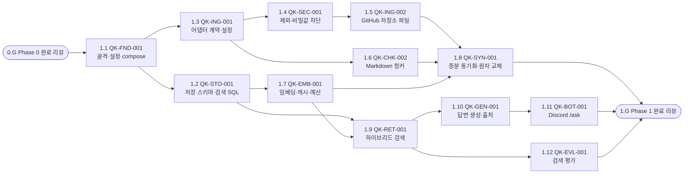

# 구축 로드맵

작업 정의(WBS 번호, 선행 작업, 규모)는 이 문서와 [WBS 보드](https://claude.ai/artifact/HoKb7gf9wXkZ8nxDcgRZAa)가 같다. 담당은 WBS 보드에서 관리한다. 작업을 추가하거나 바꾸면 이 문서와 보드를 함께 고치고, 이미 상태가 기록된 작업의 WBS 번호는 바꾸지 않는다.

진행 상태는 3절 표의 `상태` 열과 2절 표의 `진행` 열에 표시한다. 두 열은 제목에 `(WBS x.y)`가 붙은 GitHub Issue에서 계산하므로 손으로 고치지 않고 `python scripts/roadmap_status.py --write`로 갱신한다. Issue가 없는 작업(회의 등)은 담당자가 직접 적고, 스크립트는 이 표시를 덮어쓰지 않는다. 여기서 `✅`는 Issue가 닫혔다는 뜻이다. Jira 이슈의 완료 판정(주간 리뷰에서 완료 조건과 증빙 확인, AGENTS.md 5절)과는 별개다. 작업 하나를 자세히 알고 싶으면 `/roadmap-explain <WBS 번호 또는 명세 ID>`(Codex는 `$roadmap-explain`)를 쓴다.

| 표시 | 뜻 | 기준 |
| --- | --- | --- |
| ✅ | 완료 | 관련 Issue가 모두 완료로 닫혔다 |
| 🔄 | 진행 중 | 열린 Issue가 있다 |
| ⬜ | 시작 전 | Issue가 없다('not planned'로 닫힌 Issue만 있는 경우 포함) |

## 1. 구축 원칙

1. **얇게 끝까지 먼저.** 첫 구현 단계(Phase 1)는 자료원 하나(저장소 Markdown 문서)로 수집→검색→답변→Discord까지 전 구간을 잇는다. 이후 단계는 이 골격에 자료원과 기능을 붙인다.
2. **단계마다 쓸 수 있는 결과를 낸다.** 단계가 끝날 때 팀이 실제로 써 볼 수 있어야 하고, 완료 조건은 관찰할 수 있는 결과로 확인한다.
3. **측정이 다음 단계를 정한다.** 각 단계 끝에 평가를 돌리고, 결과에 따라 다음 단계 범위를 조정한다(constitution C-04).
4. **명세 단위로 일한다.** Jira 이슈 하나는 명세 하나의 이번 주 산출물이다. 명세가 승인되기 전에는 구현 PR을 열지 않는다. 구현 브랜치마다 `TASK.md`를 두어 이번 주 범위를 명세의 수용 기준 일부로 좁힌다(AGENTS.md 1절).
5. **단계 게이트를 지난 뒤 다음 단계를 시작한다.** 각 단계의 마지막 작업은 완료 리뷰(`N.G`)다. 다음 단계의 작업은 명세 백로그의 선행 작업에 더해 직전 단계의 완료 리뷰가 끝나야 시작한다.

## 2. 단계 한눈에 보기

| 단계 | 목표 | 핵심 산출물 | 완료 조건 요약 | 작업량(인일, 추정) | 진행 |
| --- | --- | --- | --- | --- | --- |
| Phase 0 | 준비·결정 | 결정된 ADR, 토큰, 자료 인벤토리, 골든셋 질문, 생산성 기준선 | 확인 필요 결정이 모두 닫힘 | 약 13~15 | ✅ 8 / 12 |
| Phase 1 | 얇은 전 구간 | 저장소 문서로 Discord `/ask` 답변 | Discord에서 출처가 붙은 답변 | 약 21~30 | ✅ 7 · 🔄 1 / 13 |
| Phase 2 | MVP 자료 확장·파일럿 | 인덱스 버전 게이트, 코드·ClickUp Docs 색인, 로그·피드백, 답변 평가, 1주 파일럿 | 팀 전원이 1주 사용, 첫 품질 리포트 | 약 15~20 | 0 / 7 |
| Phase 3 | 진행 상황·변경 맥락 | ClickUp Tasks·GitHub PR 수집, `/status`, 스레드 대화 | 회의에서 `/status`로 진행 공유 | 약 15~22 | 0 / 9 |
| Phase 4 | 명세 자료 확장 | OpenAPI·DB·Figma·Terraform, 교차 관계, 구현 여부 판정 | UC-02·09·10·11 평가 통과 | 약 10~14 | 0 / 7 |
| Phase 5 | 운영 안정화·효과 측정 | 대시보드·알림, 정합성 리포트, 사후 실측 보고 | 사용 전후 비교 보고서 | 약 6~8 | 0 / 5 |
| Phase 6 | 후순위 확장 | MCP 서버, AWS 상태 조회 등 | 필요가 확인된 항목만 | 약 9~13 (후보, 일정 계산 제외) | 0 / 5 |

작업량은 WBS 작업 규모(S≈1인일, M≈2~3인일, L≈5인일, 리뷰·테스트 포함)를 더한 추정이다. Phase 0은 회의·조사 작업도 작업마다 S 이상으로 잡은 상한이고, Phase 2에는 파일럿(M)이 들어 있다. 완료 리뷰(`N.G`)는 공수 0으로 센다. Phase 0~5 합계는 약 80~109인일이다. 주당 투입 가능한 인일(예: 2명 × 주 3일 = 6인일)로 나눠 일정을 잡고, Phase 0에서 실제 투입 가능 시간을 확인한 뒤 고친다.

## 3. 단계별 상세

### Phase 0 — 준비·결정 (약 1주)

**목표**: 구현을 막는 결정과 접근 권한을 모두 해결하고, 효과를 비교할 기준선을 남긴다.

| WBS | 상태 | 할 일 | 선행 | 크기 | 산출물 | 관련 |
| --- | --- | --- | --- | --- | --- | --- |
| 0.1 | ⬜ | SDD 문서 리뷰·원칙 합의: constitution 합의, 열린 질문(Q-1~Q-9) 검토 | — | S | 리뷰 회의 결과(합의한 원칙, 남은 질문) | Q-1~Q-9 |
| 0.2 | ✅ [#3](https://github.com/Qello-Labs/qello-knowledge/issues/3) | 자료 인벤토리: 저장소 목록(기본 브랜치·언어·크기), ClickUp Space·Folder 구조, 회의록 위치·형식, OpenAPI 노출 위치, DB 접근 가능 여부, Figma 파일 목록·소유자·좌석 | — | S | `docs/sdd/research/inventory.md` | Q-5, 6, 7, 9 |
| 0.3 | ✅ [#8](https://github.com/Qello-Labs/qello-knowledge/issues/8) | Notion→ClickUp 이전 품질 확인: 문서 5개를 ClickUp API로 Markdown 변환해 표·토글·이미지·링크 손실 확인, `access_scope` 판별 방법 조사 | — | S | `docs/sdd/research/clickup-migration-check.md` | RISK-01 |
| 0.4 | ✅ [#16](https://github.com/Qello-Labs/qello-knowledge/issues/16) | ClickUp 작성 규칙 합의·적용: 폴더 구조, 회의록 템플릿, 용어집, '파트' 필드 | 0.1, 0.3 | S | sources.md 7절 확정, ClickUp 반영 | Q-3, Q-4 |
| 0.5 | ✅ [#11](https://github.com/Qello-Labs/qello-knowledge/issues/11) | 계정·토큰 발급: GitHub 세분화 토큰(읽기), ClickUp 수집 전용 계정 토큰, Cloudflare 토큰(Workers AI 전용), Discord 애플리케이션·봇, (선택) DB 읽기 전용 계정, Figma 토큰 | 0.2 | S | `docs/sdd/research/tokens.md`(권한 범위만, 값 제외) | FR-SEC-02 |
| 0.6 | ✅ [#14](https://github.com/Qello-Labs/qello-knowledge/issues/14) | Workers AI 확인: embeddinggemma 입력 한도·Neurons 단가·질의/문서 접두 형식, 무료 할당 초과 시 동작, 생성 후보 모델로 한국어 질문 5개 답변 비교 | 0.5 | S | `docs/sdd/research/spike-workers-ai.md` | ADR-002, 009 |
| 0.7 | ⬜ | 골든셋 v0 질문 수집(팀원당 10개 이상, 합계 50문항 이상) | — | S | `eval/golden/v0.jsonl`(질문·유형만, 라벨은 Phase 1) | evaluation.md 1절 |
| 0.8 | ⬜ | 생산성 과제 세트 A·B 작성, 기준선 측정. 봇을 쓰기 시작하면 다시 잴 수 없으므로 Phase 1 전에 끝낸다 | 0.7 | M | `eval/productivity/baseline-<날짜>.md`(팀원은 P1~Pn으로 표기) | evaluation.md 4절 |
| 0.9 | ✅ [#18](https://github.com/Qello-Labs/qello-knowledge/issues/18) | 열린 결정 확정: `확인 필요` ADR(ADR-008 실행 환경·비용 상한, ADR-009 생성 모델, ADR-016 질의 원문 저장) 결정 | 0.1, 0.2, 0.6 | S | 결정 기록(`templates/decision-record.md` 양식) | ADR-008, 009, 016 |
| 0.10 | ✅ [#5](https://github.com/Qello-Labs/qello-knowledge/issues/5) | AGENTS.md 3.1 색인 대상 목록 수정(Notion→ClickUp). AGENTS.md는 사람 승인 후에만 고친다 | 0.1 | S | AGENTS.md 변경 PR | AGENTS.md 4절 |
| 0.11 | ✅ [#24](https://github.com/Qello-Labs/qello-knowledge/issues/24) | Phase 1 첫 명세 작성·승인: QK-FND-001, QK-STO-001, QK-ING-001 | 0.9 | M | `specs/<ID>/spec.md` |  |
| 0.G | ⬜ | Phase 0 완료 리뷰: 아래 완료 조건 확인 | 0.4, 0.8, 0.10, 0.11 | — | 리뷰 결과, WBS 보드 `0.G` 완료 체크 |  |

**완료 조건** (`0.G`에서 확인)

- [ ] `확인 필요` 상태의 ADR이 없다(또는 결정 기한과 담당이 정해져 있다).
- [ ] Phase 1에 필요한 토큰(GitHub, Cloudflare, Discord)이 발급되어 실행 환경에서 호출이 확인됐다.
- [ ] 골든셋 질문이 50개 이상이고 유형 분포가 evaluation.md 1.1과 크게 다르지 않다.
- [ ] 기준선 측정 기록이 있다.
- [ ] 첫 명세 3개가 승인됐다.

### Phase 1 — 얇은 전 구간

**목표**: 저장소의 Markdown 문서(ADR, 기능 명세, PLAN, 하네스, README)만으로 Discord에서 출처가 붙은 답을 받는다. 코드 청커와 ClickUp은 다음 단계로 미룬다.

선행과 크기는 4절 명세 백로그를 따른다. 이 표는 진행 상태를 표시하려고 둔다.

| WBS | 상태 | 명세 | 내용 |
| --- | --- | --- | --- |
| 1.1 | ✅ [#28](https://github.com/Qello-Labs/qello-knowledge/issues/28) | QK-FND-001 | 프로젝트 골격·설정 로딩·docker compose·CI(테스트·린트·비밀값 검사) |
| 1.2 | ✅ [#33](https://github.com/Qello-Labs/qello-knowledge/issues/33) | QK-STO-001 | 저장 스키마·마이그레이션·검색 SQL |
| 1.3 | ✅ [#34](https://github.com/Qello-Labs/qello-knowledge/issues/34) | QK-ING-001 | 자료원 어댑터 계약·자료원 설정·호출 한도·재시도 |
| 1.4 | ✅ [#37](https://github.com/Qello-Labs/qello-knowledge/issues/37) | QK-SEC-001 | 색인 제외 경로·비밀값 차단·접근 범위(`access_scope`) |
| 1.5 | ✅ [#41](https://github.com/Qello-Labs/qello-knowledge/issues/41) | QK-ING-002 | GitHub 저장소 파일 수집(트리 비교, 포함·제외 패턴) |
| 1.6 | ✅ [#46](https://github.com/Qello-Labs/qello-knowledge/issues/46) | QK-CHK-002 | Markdown 청커(저장소 문서·ClickUp 페이지 공용), 검색 헤더 |
| 1.7 | ✅ [#42](https://github.com/Qello-Labs/qello-knowledge/issues/42) | QK-EMB-001 | 임베딩 Provider(Workers AI), 캐시, 사용량 기록, 일일 예산, 실행 전 사용량 미리 보기 |
| 1.8 | 🔄 [#48](https://github.com/Qello-Labs/qello-knowledge/issues/48) | QK-SYN-001 | 증분 동기화, 문서 단위 원자적 교체, 실행 기록, 스케줄러, CLI |
| 1.9 | ⬜ | QK-RET-001 | 하이브리드 검색, RRF, 문맥 확장, 토큰 예산, 키워드 검색 텍스트 |
| 1.10 | ⬜ | QK-GEN-001 | 프롬프트, 출처 표시, 확인 불가·충돌 처리, 생성 Provider |
| 1.11 | ⬜ | QK-BOT-001 | Discord `/ask`, 지연 응답, 답변 표시·분할, 접근 제어, 오류 안내 |
| 1.12 | ⬜ | QK-EVL-001 | 골든셋 형식 검증, 검색 평가 실행기, 비교 리포트 |
| 1.G | ⬜ | Phase 1 완료 리뷰 | 아래 완료 조건 확인. 선행: 1.8, 1.11, 1.12 |

**진행 순서**

1. QK-FND-001 → QK-STO-001·QK-ING-001(병렬). 저장 스키마 스파이크에서 ADR-007(자체 스키마 vs PGVectorStore)을 확정한다.
2. 색인 트랙: QK-SEC-001 → QK-ING-002·QK-CHK-002 → QK-EMB-001 → QK-SYN-001. **첫 실제 색인은 QK-SEC-001이 끝난 뒤에만 돌린다.**
3. 질의 트랙: QK-RET-001 → QK-GEN-001 → QK-BOT-001. 색인 트랙과 병렬로 진행하되, 처음에는 고정 샘플 데이터로 개발한다.
4. 평가 트랙: 골든셋 중 저장소 문서로 답할 수 있는 문항의 라벨을 달고 QK-EVL-001로 첫 검색 평가를 돌린다. ADR-010(키워드 검색 텍스트) 비교도 여기서 한다.

**완료 조건** (`1.G`에서 확인. 선행: 1.8, 1.11, 1.12)

- [ ] 대상 저장소의 Markdown 문서가 색인되고, 변경이 없는 재동기화에서 임베딩 호출이 0건이다.
- [ ] 문서 1개를 고치면 다음 동기화에서 그 문서의 청크만 교체되고, 지운 문서는 검색되지 않는다.
- [ ] 비밀값을 심은 샘플 파일이 색인되지 않는다.
- [ ] 허용된 Discord 채널에서 `/ask`가 3초 안에 처리 중 응답을 보내고, 출처 링크가 붙은 답변으로 갱신된다.
- [ ] 자료에 없는 질문에 "확인할 수 없습니다"로 답한다.
- [ ] 첫 검색 평가 리포트(Recall@5, MRR, 벡터·키워드·하이브리드 비교)가 있다. 목표 미달이어도 기록한다.
- [ ] 접근 범위를 확인할 수 없는 샘플 문서가 검색되지 않는다.
- [ ] ADR-007, ADR-010이 확정됐다.

**하지 않는 것**: 코드 청킹, ClickUp, 질문 분류, 스레드 대화, 대시보드

### Phase 2 — MVP 자료 확장·파일럿

**목표**: 질문의 대부분을 차지하는 코드와 ClickUp 문서를 붙이고, 팀이 1주 동안 실제로 쓰면서 품질을 잰다.

2.1~2.5는 `1.G` 뒤에 함께 시작할 수 있고, 파일럿(2.6)은 2.1~2.5가 모두 끝난 뒤 시작한다.

| WBS | 상태 | 명세 | 내용 |
| --- | --- | --- | --- |
| 2.1 | ⬜ | QK-STO-002 | 인덱스 버전 생성·평가 게이트·활성화. Phase 1 평가 결과로 청킹·검색 설정을 고칠 때 이 절차를 처음 쓴다. |
| 2.2 | ⬜ | QK-CHK-001 | Java·Kotlin 코드 청커(클래스 요약·메서드·Android 컴포넌트), 코드 메타데이터, 식별자 분해 |
| 2.3 | ⬜ | QK-ING-003 | ClickUp Docs 수집, 문서 분류, 회의록 메타데이터, 용어집 |
| 2.4 | ⬜ | QK-OBS-001 | 질의 로그, 👍/👎 피드백, `/sources`, 질의 원문 저장 옵션 |
| 2.5 | ⬜ | QK-EVL-002 | 답변 평가(충실성·관련성·인용 정확도·확인 불가), 생성 모델 후보 비교 → ADR-009 확정 |
| 2.6 | ⬜ | 파일럿 1주 (크기 M, 달력 기준 1주) | 팀 전원 사용, 👎 사례와 실패 유형 분류, 골든셋 후보 수집. 선행: 2.1~2.5 |
| 2.G | ⬜ | Phase 2 완료 리뷰 | 아래 완료 조건 확인. 선행: 2.6 |

**완료 조건** (`2.G`에서 확인)

- [ ] 백엔드·Android 저장소 코드와 ClickUp Docs가 색인되고 정해진 주기로 동기화된다.
- [ ] 골든셋(코드·문서·회의·종합·답 없음 유형) 검색·답변 평가 리포트가 있다.
- [ ] 파일럿 기간 질의 로그와 피드백이 쌓였고, 실패 유형별 개선 목록이 우선순위와 함께 정리됐다.
- [ ] 답변 지연 p95가 측정됐다(NFR-02 비교).
- [ ] 생성 모델이 확정됐다(ADR-009).
- [ ] 청킹·검색 설정을 바꿔 새 인덱스 버전을 만들고, 평가를 통과한 뒤 활성화하는 절차를 한 번 실행했다.

**단계 리뷰에서 정할 것**: 기본 순서는 Phase 3(진행 상황) → Phase 4(명세 자료)다. WBS 보드에서도 Phase 4 작업은 `3.G` 뒤에 시작한다. 파일럿 결과로 Phase 4를 먼저 하기로 하면 이 문서의 단계 순서와 WBS 보드의 선후관계를 함께 고친다. 품질 개선(청킹·프롬프트)을 먼저 할지도 여기서 정한다.

### Phase 3 — 진행 상황·변경 맥락

**목표**: 정기 회의에서 반복되는 "어디까지 했어?"와 "왜 바뀌었어?"에 답한다.

| WBS | 상태 | 명세 | 내용 |
| --- | --- | --- | --- |
| 3.1 | ⬜ | QK-ING-004 | ClickUp Tasks 수집, 작업 스냅샷 |
| 3.2 | ⬜ | QK-ING-005 | GitHub PR·Issue·Release 수집, 템플릿 필드 추출 |
| 3.3 | ⬜ | QK-CHK-003 | 명세 ID·작업·PR·Issue·회의 액션 아이템 연결 관계 |
| 3.4 | ⬜ | QK-TRK-001 | 질문 분류(지식·상태·혼합), 필터 추론 |
| 3.5 | ⬜ | QK-TRK-002 | 진행 현황·기능 단위 상태, `/status` |
| 3.6 | ⬜ | QK-RET-002 | 관계 기반 후보 확장, 변경 맥락 답변 |
| 3.7 | ⬜ | QK-BOT-002 | 스레드 후속 질문, 질의 재작성 |
| 3.8 | ⬜ | QK-SYN-002 | Discord `/reindex`, 실패 문서 재시도 |
| 3.G | ⬜ | Phase 3 완료 리뷰 | 아래 완료 조건 확인. 선행: 3.5, 3.6, 3.7, 3.8 |

**완료 조건** (`3.G`에서 확인)

- [ ] `/status`가 파트별 작업 집계와 진행 중 작업, 조회 시각을 보여 준다. 원본 조회 실패 시 스냅샷임을 표시한다.
- [ ] 같은 명세 ID의 Android·Backend 작업과 연결 PR이 함께 나온다.
- [ ] UC-01·04·12 유형 골든셋 문항 평가가 있다.
- [ ] 정기 회의 1회에서 `/status`로 진행 상황을 공유해 보고 의견을 받았다.
- [ ] 스레드 후속 질문("그럼 프론트는?")이 직전 주제를 이어받는다.

### Phase 4 — 명세 자료 확장

**목표**: API·DB·디자인·인프라 자료를 붙이고, 자료를 엮어 "구현돼 있어?"에 답한다.

| WBS | 상태 | 명세 | 내용 |
| --- | --- | --- | --- |
| 4.1 | ⬜ | QK-ING-006 | OpenAPI 수집, 엔드포인트 청킹 |
| 4.2 | ⬜ | QK-ING-007 | Flyway 마이그레이션·DB 스키마 수집 |
| 4.3 | ⬜ | QK-CHK-004 | API ↔ 컨트롤러 ↔ Retrofit ↔ 테이블 ↔ 테스트 교차 관계, 경로 정규화 |
| 4.4 | ⬜ | QK-TRK-003 | API 구현 여부 판정 |
| 4.5 | ⬜ | QK-ING-008 | Figma 프레임 수집(좌석·한도·소유권 해결 후) |
| 4.6 | ⬜ | QK-ING-009 | Terraform 수집 |
| 4.G | ⬜ | Phase 4 완료 리뷰 | 아래 완료 조건 확인. 선행: 4.4, 4.5, 4.6 |

**완료 조건** (`4.G`에서 확인)

- [ ] OpenAPI 엔드포인트 수와 색인된 엔드포인트 수가 같다.
- [ ] 샘플 API 10개에서 컨트롤러·Retrofit·OpenAPI가 같은 엔티티 키로 모인다(정확도 기록).
- [ ] UC-02·09·10·11 유형 골든셋 문항 평가가 있다.
- [ ] Figma 수집이 파일 버전이 바뀔 때만 본문 API를 호출한다.

### Phase 5 — 운영 안정화·효과 측정

| WBS | 상태 | 명세 | 내용 |
| --- | --- | --- | --- |
| 5.1 | ⬜ | QK-OBS-002 | Grafana 대시보드·알림 |
| 5.2 | ⬜ | QK-SYN-003 | 주기적 전체 대조(삭제 반영), DB 백업·복구 절차, 재색인 절차 문서 |
| 5.3 | ⬜ | QK-TRK-004 | API·코드·DB 정합성 주간 리포트, 정기 회의 전 진행 요약 게시 |
| 5.4 | ⬜ | QK-EVL-003 | 생산성 사후 측정(과제 세트 B), 전후 비교 보고서 |
| 5.G | ⬜ | Phase 5 완료 리뷰 | 아래 완료 조건 확인. 선행: 5.1~5.4 |

**완료 조건** (`5.G`에서 확인)

- [ ] 대시보드가 저장소의 정의 파일로 재현되고, 알림 3종을 흉내 내 Discord로 받았다.
- [ ] 서버를 새로 만들어 원본에서 색인을 다시 만드는 절차를 한 번 실행해 봤다.
- [ ] 정합성 리포트가 일부러 만든 불일치를 찾는다.
- [ ] 사용 전후 비교 보고서(팀원별, 평균·중앙값, 조건 명시)를 팀에 공유했다.
- [ ] Phase 6 후보의 우선순위를 측정 결과로 정했다.

### Phase 6 — 후순위 확장 (필요가 확인된 것만)

모든 후보는 `5.G` 뒤에 시작한다. 후보이므로 크리티컬 패스 계산에서 빼고, 이 단계에는 완료 리뷰를 두지 않는다.

| WBS | 상태 | 명세 후보 | 내용 | 크기(추정) | 도입 조건 |
| --- | --- | --- | --- | --- | --- |
| 6.1 | ⬜ | QK-MCP-001 | MCP 서버(지식 검색, 엔티티 조회, 진행 현황 도구) — 팀원의 코딩 에이전트에서 직접 조회 | M | 팀원이 IDE·에이전트에서 쓰고 싶다는 요구가 반복될 때 |
| 6.2 | ⬜ | QK-TRK-005 | AWS 현재 상태 조회(읽기 전용 IAM, CloudWatch) | M | 인프라 상태 질문이 실제로 나올 때 |
| 6.3 | ⬜ | QK-SYN-004 | ClickUp 작업 웹훅 반영 | S | 1시간 지연에 대한 불만이 반복될 때 |
| 6.4 | ⬜ | QK-RET-003 | 리랭커 | M | ADR-012 재검토 조건 충족 |
| 6.5 | ⬜ | QK-ING-010 | Discord 대화 기록 수집 | M | 결정이 Discord에서만 일어나는 일이 잦을 때 |

## 4. 명세 백로그

선행 열은 기술적으로 먼저 끝나야 하는 명세다. WBS 보드는 여기에 단계 게이트를 더해, 각 단계의 작업이 직전 단계 완료 리뷰(`N.G`) 뒤에 시작하게 한다. 예를 들어 QK-ING-006의 선행은 QK-SYN-001이지만 실제 시작은 `3.G` 뒤다. 단계별 게이트: Phase 1 ← `0.G`, Phase 2 ← `1.G`, Phase 3 ← `2.G`, Phase 4 ← `3.G`, Phase 5 ← `4.G`. 파일럿(2.6)과 완료 리뷰(`N.G`)는 명세가 아니라서 이 표에 없고 3절 각 단계 표에 있다.

| ID | WBS | 제목 | 단계 | 요구사항 | 선행 | 크기 |
| --- | --- | --- | --- | --- | --- | --- |
| QK-FND-001 | 1.1 | 프로젝트 골격·설정 로딩·docker compose·CI(테스트·린트·비밀값 검사) | 1 | FR-ING-10, FR-SEC-01, NFR-10, NFR-12, ADR-017 | — | M |
| QK-STO-001 | 1.2 | 저장 스키마·마이그레이션·검색 SQL | 1 | FR-STO-01~03, ADR-006·007 | FND-001 | M |
| QK-ING-001 | 1.3 | 자료원 어댑터 계약·자료원 설정·호출 한도·재시도 | 1 | FR-ING-01, 10, 11 | FND-001 | S |
| QK-SEC-001 | 1.4 | 색인 제외 경로·비밀값 차단·접근 범위(`access_scope`) | 1 | FR-SEC-03, FR-SEC-06, sources.md 8절 | ING-001 | S |
| QK-ING-002 | 1.5 | GitHub 저장소 파일 수집(트리 비교, 포함·제외 패턴) | 1 | FR-ING-02, FR-SYN-02(파일) | SEC-001 | M |
| QK-CHK-002 | 1.6 | Markdown 청커(저장소 문서·ClickUp 페이지 공용), 검색 헤더 | 1 | FR-CHK-01~05, 08 | ING-001 | S |
| QK-EMB-001 | 1.7 | 임베딩 Provider(Workers AI), 캐시, 사용량 기록, 일일 예산, 실행 전 사용량 미리 보기 | 1 | FR-EMB-01~04, 06 | STO-001 | M |
| QK-SYN-001 | 1.8 | 증분 동기화, 문서 단위 원자적 교체, 실행 기록, 스케줄러, CLI | 1 | FR-SYN-01, 03, 04, 05(CLI), 06 | ING-002, CHK-002, EMB-001 | M |
| QK-RET-001 | 1.9 | 하이브리드 검색, RRF, 문맥 확장, 토큰 예산, 키워드 검색 텍스트 | 1 | FR-RET-01~03, 07, 08, FR-CHK-07, ADR-010 | STO-001, EMB-001 | M |
| QK-GEN-001 | 1.10 | 프롬프트, 출처 표시, 확인 불가·충돌 처리, 생성 Provider | 1 | FR-GEN-01~08 | RET-001 | M |
| QK-BOT-001 | 1.11 | Discord `/ask`, 지연 응답, 답변 표시·분할, 접근 제어, 오류 안내 | 1 | FR-BOT-01, 02, 06, 07 | GEN-001 | M |
| QK-EVL-001 | 1.12 | 골든셋 형식 검증, 검색 평가 실행기, 비교 리포트 | 1 | FR-EVL-01, 02, 04 | RET-001 | M |
| QK-STO-002 | 2.1 | 인덱스 버전 생성·평가 게이트·활성화 | 2 | FR-STO-04, FR-EMB-05, ADR-018 | STO-001, EVL-001 | M |
| QK-CHK-001 | 2.2 | 코드 청커(Java·Kotlin, Android 컴포넌트, 테스트), 코드 메타데이터 | 2 | FR-CHK-01~05, 07, 08, sources.md 3.1~3.3 | CHK-002 | L |
| QK-ING-003 | 2.3 | ClickUp Docs 수집, 문서 분류, 회의록·용어집 처리 | 2 | FR-ING-03, sources.md 3.5 | SYN-001 | M |
| QK-OBS-001 | 2.4 | 질의 로그, 피드백 버튼, `/sources`, 질의 원문 저장 옵션 | 2 | FR-OBS-01, FR-BOT-04, 05(`/sources`), FR-SEC-04 | BOT-001 | M |
| QK-EVL-002 | 2.5 | 답변 평가, 판정 모델·사람 표본 검토, 생성 모델 비교 | 2 | FR-EVL-03, ADR-009 | GEN-001, EVL-001 | M |
| QK-ING-004 | 3.1 | ClickUp Tasks 수집, 작업 스냅샷 | 3 | FR-ING-04, sources.md 3.6 | SYN-001 | M |
| QK-ING-005 | 3.2 | GitHub PR·Issue·Release 수집, 템플릿 필드 추출 | 3 | FR-ING-05, sources.md 3.7 | SYN-001 | M |
| QK-CHK-003 | 3.3 | 명세·작업·PR·Issue·회의 연결 관계 | 3 | FR-CHK-06(일부) | ING-004, ING-005 | M |
| QK-TRK-001 | 3.4 | 질문 분류, 필터 추론 | 3 | FR-TRK-01, FR-RET-04 | GEN-001 | M |
| QK-TRK-002 | 3.5 | 진행 현황·기능 단위 상태, `/status` | 3 | FR-TRK-02, 03, FR-BOT-05 | ING-004, CHK-003, TRK-001 | M |
| QK-RET-002 | 3.6 | 관계 기반 후보 확장, 변경 맥락 | 3 | FR-RET-06, FR-TRK-05 | CHK-003 | M |
| QK-BOT-002 | 3.7 | 스레드 대화, 질의 재작성 | 3 | FR-BOT-03, FR-RET-05, ADR-015 | OBS-001 | M |
| QK-SYN-002 | 3.8 | Discord `/reindex`, 실패 문서 재시도 | 3 | FR-SYN-05(Discord), FR-SYN-07 | SYN-001, BOT-001 | S |
| QK-ING-006 | 4.1 | OpenAPI 수집, 엔드포인트 청킹 | 4 | FR-ING-06, sources.md 3.8 | SYN-001 | S |
| QK-ING-007 | 4.2 | DB 스키마·마이그레이션 수집 | 4 | FR-ING-07, sources.md 3.9 | SYN-001 | M |
| QK-CHK-004 | 4.3 | API·코드·Retrofit·테이블·테스트 교차 관계, 경로 정규화 | 4 | FR-CHK-06(나머지), sources.md 5절 | CHK-001, ING-006, ING-007 | M |
| QK-TRK-003 | 4.4 | API 구현 여부 판정 | 4 | FR-TRK-04 | CHK-004, TRK-001 | M |
| QK-ING-008 | 4.5 | Figma 프레임 수집 | 4 | FR-ING-08, sources.md 3.10 | SYN-001 | M |
| QK-ING-009 | 4.6 | Terraform 수집 | 4 | FR-ING-09, sources.md 3.11 | SYN-001 | S |
| QK-OBS-002 | 5.1 | Grafana 대시보드·알림 | 5 | FR-OBS-02, 03 | OBS-001 | M |
| QK-SYN-003 | 5.2 | 전체 대조 삭제 반영, 백업·복구·재색인 절차 | 5 | FR-SYN-02(전체), NFR-04, NFR-10 | SYN-001 | S |
| QK-TRK-004 | 5.3 | 정합성 리포트, 회의 전 진행 요약 게시 | 5 | FR-TRK-06, 07 | CHK-004, TRK-002 | M |
| QK-EVL-003 | 5.4 | 생산성 사후 측정, 전후 비교 보고 | 5 | FR-EVL-05 | Phase 2 이후 | S |

## 5. 바로 시작할 일 (Phase 0 첫 주)

1. 이 문서 묶음(`docs/sdd/`)을 팀에 공유하고 리뷰 회의(60분)를 잡는다(0.1). 안건: constitution 합의, Q-1~Q-9, ADR-008·009·016.
2. 골든셋 질문 수집을 공지한다(0.7). 팀원당 10개, "최근 실제로 했거나 받은 질문"을 기준으로 한다. 기한은 리뷰 회의 전.
3. 자료 인벤토리(0.2)와 ClickUp 이전 품질 확인(0.3)을 진행한다. 둘 다 리뷰 회의 전에 끝내면 Q-3~Q-7 결정이 빨라진다.
4. Cloudflare·GitHub·Discord 토큰부터 발급한다(0.5, Phase 1에 필요한 것). ClickUp·Figma·DB는 Phase 2·4 전까지 준비한다.
5. Workers AI 확인(0.6)을 한다. 특히 embeddinggemma의 입력 한도와 Neurons 단가는 청크 크기와 비용 추정에 바로 쓰인다.
6. 생산성 과제 세트 A·B를 만들고 기준선을 잰다(0.8). **RAG를 쓰기 시작하면 기준선을 다시 잴 수 없으므로 Phase 1 시작 전에 끝낸다.**
7. 리뷰 회의 결과로 열린 결정을 확정하고(0.9), QK-FND-001, QK-STO-001, QK-ING-001 명세를 쓰고 승인한다(0.11). Phase 0 완료 리뷰(0.G)를 마치면 Phase 1을 시작한다.
8. 구현을 시작할 때는 최신 `main`에서 작업 브랜치를 만들고 [`templates/task-contract.md`](../../templates/task-contract.md)로 `TASK.md`를 써서 Jira 이슈·명세 ID와 연결한다(AGENTS.md 1절).

## 6. 위험

| ID | 위험 | 영향 | 대응 | 확인 시점 |
| --- | --- | --- | --- | --- |
| RISK-01 | Notion에서 옮긴 문서의 표·토글·DB 구조가 ClickUp에서 깨지거나 Docs와 Tasks로 흩어진다 | 문서 검색 품질 저하 | Phase 0 샘플 변환 확인, 이전 체크리스트, 중요 문서 우선 정리 | Phase 0 |
| RISK-02 | ClickUp 개인 API 토큰은 범위를 지정할 수 없고 그 사용자의 모든 권한을 갖는다 | 수집 범위 초과, 토큰 유출 시 피해 확대 | 수집 전용 계정에 필요한 Space만 공유, 토큰은 서버 환경 파일에만 보관 | Phase 0 |
| RISK-03 | Figma View·Collab 좌석은 파일 본문 조회가 월 단위로 제한된다. 떠난 디자이너가 파일을 소유하고 있을 수 있다 | 디자인 자료 수집 불가 | Dev·Full 좌석 확보, 소유권 이전, 버전 확인 후에만 본문 조회, 주 1회 주기 | Phase 0, 4 |
| RISK-04 | Workers AI 무료 할당(일 10,000 Neurons) 초과, 모델 가격·지원 종료 변경 | 응답 실패, 재임베딩 필요 | 일일 예산 가드, 실행 전 사용량 미리 보기, Provider 분리, 인덱스 버전 절차(QK-STO-002) | 상시 |
| RISK-05 | 한국어 활용형·식별자 키워드 검색 품질이 낮다 | 함수명·API 경로 질문 실패 | ADR-010 비교 평가, 식별자 분해 | Phase 1 |
| RISK-06 | 원본 문서 자체가 오래됐다 | 오래된 근거로 답함 | 수정 시각 표시, 충돌 표시, 아카이브 규칙, 정합성 리포트 | Phase 2, 5 |
| RISK-07 | 팀이 쓰지 않는다 | 효과 측정 불가 | 파일럿, 회의에 `/status` 연결, 피드백을 다음 주 개선에 반영해 공유 | Phase 2~3 |
| RISK-08 | 단일 서버 장애·데이터 손실 | 일시 중단 | 원본이 진실이므로 재색인으로 복구, 로그·피드백·평가 결과만 백업 | Phase 5 |
| RISK-09 | 코드 안의 비밀값이 외부 API로 전송된다 | 보안 사고 | QK-SEC-001을 첫 색인 전에 완료, 차단 기록 검토 | Phase 1 |
| RISK-10 | 답변 환각 | 잘못된 판단 | 근거 규칙 프롬프트, 확인 불가 응답, 충실성 평가 | Phase 1~2 |
| RISK-11 | 팀원 투입 시간이 부족하다 | 일정 지연 | 단계마다 쓸 수 있는 결과, 명세 크기를 작게 유지, 단계 리뷰에서 범위 조정 | 상시 |

## 7. 단계 리뷰 운영

- 각 단계의 마지막 주간 리뷰에서 완료 조건 체크리스트를 하나씩 확인한다. 증빙(테스트 결과, 평가 리포트, 화면 기록) 링크를 Jira 이슈에 남긴다.
- 리뷰를 마치면 WBS 보드에서 그 단계의 완료 리뷰(`N.G`)를 완료로 체크한다. 이 체크가 다음 단계 작업의 "시작 가능" 표시를 연다.
- 완료 조건을 못 채운 항목은 다음 단계로 넘기거나 범위에서 빼고, 그 결정을 이 문서에 기록한다.
- 단계 리뷰마다 평가를 돌려 지표 추이를 남긴다(evaluation.md 6절).
